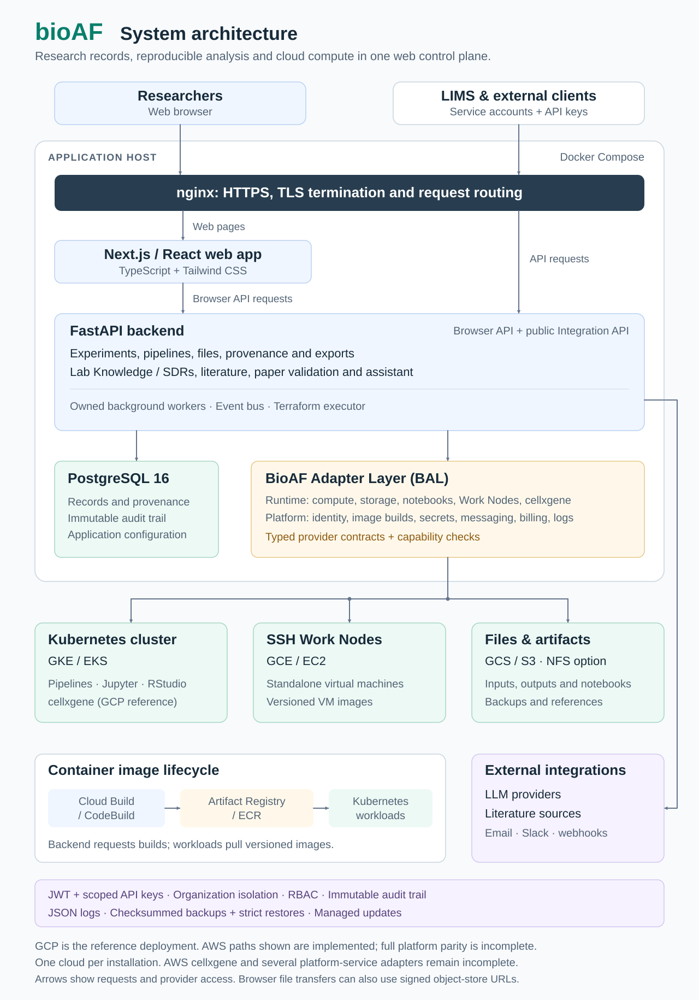

<p align="center">
  
</p>

<h1 align="center">bioAF</h1>
<p align="center"><strong>Computational Biology Automation Framework</strong></p>

bioAF is a web platform for small biotech teams to organize experiments, run computational biology pipelines,
and keep research data connected to the work that produced it. It manages cloud infrastructure through
UI-driven Terraform, with Google Cloud as the reference deployment and partial AWS implementations.

## Features

- **Research records:** experiments, samples, Sample Batches, Sequencing Batches, templates and cross-experiment Projects.
- **Pipelines:** an nf-core Pipeline Catalog, versioned Custom Pipelines, launch validation, run monitoring, QC and review handoff.
- **Interactive analysis:** Jupyter and RStudio Notebook Sessions, standalone SSH Work Nodes, and versioned compute environments.
- **Data and provenance:** file upload and browsing, input/output lineage, analysis snapshots, bounded data exports and GEO metadata packages.
- **Lab Knowledge:** Literature Library, Lab Documents, Lab Glossary and Scientific Decision Records (SDRs).
- **AI assistance:** a conversational assistant, advisory Agent Review, AI Literature Review and beta paper-validation workflows.
- **Administration:** custom roles and permissions, an immutable Audit Log, email/Slack notifications, cost reporting, backups and managed updates.
- **Integrations:** a public service-account/API-key REST API and signed outbound webhooks.

Feature availability depends on permissions, enabled components, provider capabilities and beta settings.
Naming Profiles parse filenames only; auto-ingest is temporarily disabled during its redesign.

## Architecture

<p align="center">
  
</p>

nginx routes browser and integration requests to the Next.js web app and a single FastAPI backend.
The backend owns background workers, the event bus and Terraform execution. PostgreSQL stores research
records, application configuration and the Audit Log. The BioAF Adapter Layer (BAL) provides typed
contracts for compute, storage, notebooks, Work Nodes, cellxgene and platform services.

Pipelines and Notebook Sessions run on Kubernetes; SSH Work Nodes run on separate virtual machines.
Environment builds publish versioned images for workloads to use. Uploaded files and analysis outputs live
in the configured storage backend. Credentials use a combination of host configuration, encrypted database
fields and supported secret-provider integrations; see [deployment configuration](docs/configuration.md).

### Cloud and backend status

| Area | GCP reference path | AWS implementation |
| --- | --- | --- |
| Kubernetes workloads | GKE with managed node pools | EKS, cluster authentication, pod identity and Cluster Autoscaler |
| Object storage | GCS | S3 |
| SSH Work Nodes | GCE virtual machines | EC2 virtual machines |
| Container builds and registry | Cloud Build and Artifact Registry | CodeBuild and ECR |
| Other platform services | GCP secrets, IAM, billing, messaging and logging adapters | Full parity is incomplete; several factories remain GCP-only |

Each installation has one `cloud_provider` (`gcp` or `aws`). Implementations in the table do not imply
that every end-to-end AWS workflow has been validated. cellxgene and several platform-service paths still
need AWS parity. NFS storage is implemented; SLURM compute and notebook adapters remain stubs.
`BIOAF_COMPUTE_MODE=local` simulates mode-aware adapters for development, but is not a complete offline mode.

See [architecture and implementation boundaries](docs/architecture.md),
[compute setup](docs/guides/compute-stack-setup.md), and the [Architecture Decision Records](decisions/README.md).

## Quick Start

### Deploy on GCP

Run the installer in a terminal on your local machine:

```bash
curl -fsSL https://raw.githubusercontent.com/bioAF/bioAF/main/install-gcp.sh | bash
```

The installer checks local prerequisites, helps configure cloud access and provisions the application VM.
Follow its automatic setup prompt or the instructions it prints. On a fresh Mac, installing Homebrew can
require your Mac password.

### Deploy on AWS

```bash
curl -fsSL https://raw.githubusercontent.com/bioAF/bioAF/main/install-aws.sh | bash
```

The AWS installer provisions an EC2 application host and its instance profile. AWS workload and platform
support is partial as described above. For installer options, run the script with `--help`.

For either cloud, the [Deployment Guide](docs/deployment-guide.md) explains prerequisites, cloud permissions,
SSH restrictions and [pinned installer versions](docs/deployment-guide.md#pinned-installer-versions).
An installer's `--ref` pins its helpers; the VM's automatic setup still uses `main`.

### Deploy on an existing server

On a Linux server with Docker, Docker Compose, Git, openssl and Python 3 (3.10 or newer):

```bash
git clone https://github.com/bioAF/bioAF.git
cd bioAF
./bioaf setup
```

Setup generates configuration and TLS certificates, pulls images and upgrades the database. Open the URL
it prints and use the one-time setup code to create the first administrator account.

### Manage an installation

Run these commands from the repository directory on the application host:

| Command | Purpose |
| --- | --- |
| `./bioaf start`, `stop`, `restart`, `status` | Manage application services |
| `./bioaf logs [service]` | Read container logs |
| `./bioaf backup` | Create a host-side database backup |
| `./bioaf update [version]` | Install the latest or a specified release |
| `./bioaf migrate` | Run the guarded database-upgrade path |
| `./bioaf build [service]` | Build local images; activate them with `start` or `restart` |
| `./bioaf shell [service]`, `dbshell` | Open a container shell or psql |
| `./bioaf help` | Show a command summary |

The host management script is separate from the in-session `bioaf` command. See
[SSH and exec access](docs/guides/ssh-access.md) and
[disk use and deployment generations](docs/deployment-guide.md#disk-use-and-deployment-generations).

## Development Setup

The project uses Python 3.12, PostgreSQL 16 and Node 20. Backend dependencies are declared in
`backend/pyproject.toml` and pinned in `backend/uv.lock`; frontend dependencies are pinned in
`frontend/package-lock.json`.

### Docker Compose

```bash
docker compose -f docker/docker-compose.dev.yml up --build
```

The development stack exposes the backend at `http://localhost:8000`, frontend at
`http://localhost:3000` and PostgreSQL at `localhost:5432`. Its database service is named `postgres`.
It sets `BIOAF_COMPUTE_MODE=local` explicitly.

### Manual development and tests

Use the [Development Guide](docs/development.md) for complete setup and test commands, including a separate
test database. Install with `uv sync --locked` and `npm ci`; commit lock changes with dependency changes.
Manual launchers and Alembic need `BIOAF_COMPUTE_MODE` and valid `BIOAF_ENCRYPTION_KEYS`.
The root `.env.example` does not supply an encryption key; complete the key setup in the Development Guide
before importing the application. Backend CLI requirements depend on the command; the offline schema
exporter supplies its own synthetic settings.

CI checks backend/frontend behavior, generated contracts, types, coverage, SDKs, shell scripts,
Terraform modules, dependencies and documentation. See [Contributing](CONTRIBUTING.md),
[backend dependencies](backend/DEPENDENCIES.md), [frontend dependencies](frontend/DEPENDENCIES.md),
and [API contract generation](backend/contracts/README.md).

## Documentation

Start at the [documentation hub](docs/README.md).

- [Bench Scientist Guide](docs/user-guide-bench.md): experiments, samples, uploads and results.
- [Computational Biologist Guide](docs/user-guide-compbio.md): pipelines, notebooks, Work Nodes and provenance.
- [Admin Guide](docs/user-guide-admin.md): access, components, costs, backups and updates.
- [Data Exports](docs/guides/data-exports.md): archive contents, limits and download links.
- [Literature and AI Workflows](docs/guides/literature-and-ai.md): source settings, review outcomes and approvals.
- [GEO Export](docs/guides/geo-export.md): submission metadata and SuperSeries packages.
- [Life After bioAF](docs/life-after-bioaf.md): retain and move data before teardown.

### Integration API

External integrations use `/api/v1/integrations`. Its live
[OpenAPI location](docs/api/README.md) is `/api/v1/integrations/openapi.json`, with Swagger UI at
`/api/v1/integrations/docs`.

- [Authentication and authorization](docs/api/auth.md)
- [Conventions](docs/api/conventions.md): errors, idempotency, cursor pagination and external IDs
- [Projects](docs/api/projects.md), [Experiments](docs/api/experiments.md), [Samples](docs/api/samples.md), [Files](docs/api/files.md)
- [Webhooks](docs/api/webhooks.md): event types, signatures and retries

The internal API has a separate [offline schema and generated frontend types](backend/contracts/README.md).
Its interactive docs and schema are disabled in production.

## Project Structure

```text
bioAF/
  backend/           FastAPI app, migrations, contracts, tests and GCP/AWS Terraform modules
  frontend/          Next.js app, generated transport types and tests
  docker/            Container builds, Compose, nginx and host-agent units
  decisions/         Historical Architecture Decision Records
  ai_guides/         Shared development process and domain language
  docs/              User, operator and developer documentation
  sdk/               Python and R analysis SDKs
  templates/         Example workflows
  installer/         Installer helpers and cloud-role manifest
  scripts/           Environment assets, CI helpers and update agent
  tests/             Host shell and integration checks
  assets/            Project logo and architecture diagram, in SVG and PNG
  bioaf              Host management script
  install*.sh        First-time setup and cloud provisioning
```

## Contributing

Read [CONTRIBUTING.md](CONTRIBUTING.md) and [ai_guides/README.md](ai_guides/README.md) before making changes.
Architecture decisions live in [decisions/](decisions/); current implementation boundaries live in
[docs/architecture.md](docs/architecture.md).
