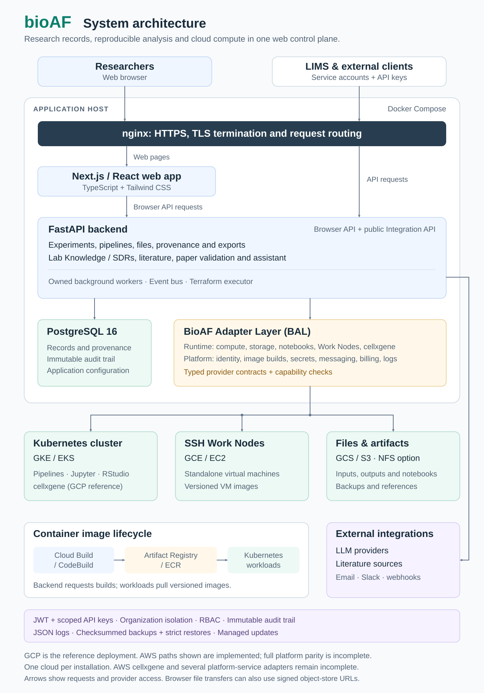

# Current Architecture

This page describes the implementation. The [Architecture Decision Records](../decisions/README.md) preserve
historical decisions; some describe earlier designs or proposed features.

[PNG export](../assets/bioAF_Architecture.png)

## Application Host

The production Compose deployment runs nginx, the Next.js frontend, a FastAPI backend and PostgreSQL 16.
nginx terminates TLS and routes `/api/` to the backend. The public Integration API is mounted at
`/api/v1/integrations` inside that same application; it is not a separately deployed service.

The backend runs the event bus, periodic jobs and request-started background work in process. Its task
owner controls admission, draining and cancellation. Ordered startup checks database compatibility before
normal startup writes or workers run. An incompatible database leaves the application in maintenance mode.
The backend executes Terraform subprocesses through the shared executor and cloud-specific configuration.

## Research Records and Provenance

Experiments own Samples; Projects group experiments and selected samples for analysis. Pipeline Runs,
registered input/output files and notebook outputs provide provenance links. Analysis snapshots record
selected object metadata and optional artifacts through the Python or R SDK.

The immutable Audit Log, Activity Feed and application logs serve different purposes. Audit records capture
explicitly audited operations and attribution; the Activity Feed presents team events; JSON application logs
support diagnosis. None is a transcript of every command executed inside a workload.

## BioAF Adapter Layer

Application services use provider contracts under `backend/app/adapters`. The runtime registry resolves
compute, storage, notebook, Work Node and cellxgene providers. Additional seams cover cloud credentials,
cluster authentication, pod identity, image builds/registries and platform services such as secrets,
messaging, logging, IAM and billing.

Structured provider results use normalized models; backend details live in provider metadata. Capabilities
gate optional functionality on both the client and server. A capability is distinct from whether a component
is currently enabled and healthy. The layering checks keep cloud SDK imports behind adapters, with an
explicit allowlist for remaining exceptions.

## Workload and Storage Boundaries

- Kubernetes runs pipeline jobs, Jupyter/RStudio Notebook Sessions and cellxgene.
- Work Nodes are standalone virtual machines, separate from the Kubernetes cluster.
- Environment builds produce versioned container or VM images. Container builds publish to a registry;
  running workloads pull those images.
- Storage providers handle files, outputs, references and backups. Supported signing capabilities determine
  whether browser transfers and export download links can use signed URLs.

Custom pipeline parameters are supplied as data through environment variables and a JSON file. Output
collection and cleanup are scoped to the run. Stored HTML/Markdown reports pass through the application's
safe-rendering path; report authors cannot depend on arbitrary active HTML being preserved.

## Cloud Support

The install-level `cloud_provider` selects one cloud. GCP is the reference implementation: GKE with managed
node pools, GCS, GCE, Cloud Build and Artifact Registry. AWS implementations exist for EKS authentication and
pod identity, S3, EC2, CodeBuild and ECR. This is partial implementation coverage, not a guarantee of parity or
validation of every end-to-end path. Several platform-service factories remain GCP-only, and AWS cellxgene
parity is incomplete.

NFS storage is implemented. SLURM compute and notebook providers are stubs; an accepted configuration value
does not make them usable. Local simulation applies only to mode-aware adapters, not every external service.

## Integration and AI Boundaries

The stable external contract is the scoped API-key Integration API. The browser uses internal endpoints,
whose offline OpenAPI artifact generates selected frontend transport types. Generated types do not validate
network responses at runtime.

Hosted LLMs and bibliographic sources are external services. Agent Review is advisory and does not itself
become scientific provenance. The conversational assistant proposes consequential actions for approval;
researchers must also approve reproduction plans before their compute steps execute. See
[Literature and AI Workflows](guides/literature-and-ai.md).

Auto-ingest and manifest ingest remain gated off during the Naming Profile redesign. Existing models and
ADRs for automation are not evidence that a general trigger editor or pipeline queue is available.

## Operational Contracts

Database upgrades use guarded migration and compatibility checks. Backups record creation-time checksums;
restores validate integrity and capacity before importing a review copy in a single transaction. Export
archives use bounded scratch, a single admission slot and explicit time/size limits. The host updater records
current/previous/candidate deployment generations and protects their images and recovery backups.

Read the [Deployment Guide](deployment-guide.md), [Configuration](configuration.md),
[Data Exports](guides/data-exports.md) and [Development Guide](development.md) for the concrete procedures.
